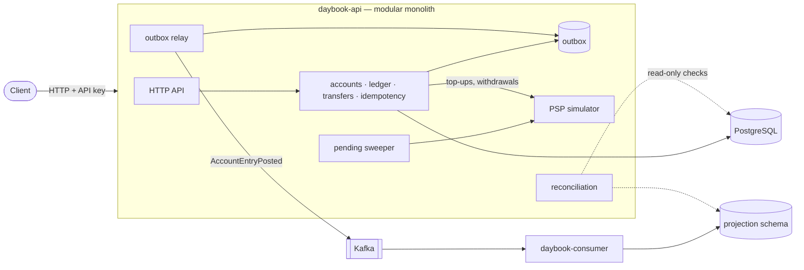

# Daybook

A wallet service backed by a **double-entry ledger**, built with Java 21 and Spring Boot 4.

Tenants hold accounts. Money moves between accounts by transfer, and in and out of the system
through a (simulated) payment provider. Every balance change is a balanced set of debit and credit
entries in an append-only ledger.

The system makes one central claim:

> **Money is never created or destroyed** — not under concurrent load, duplicate requests,
> process crashes or a failing payment provider.

The rest of this README is how that claim is enforced, and how it is checked: by the database
itself, by tests, by a chaos test that kills processes under load, and by a reconciliation job
that re-proves it every five minutes in production.

---

## Quick start

Needs only **Docker** (Docker Desktop on Windows/macOS).

```bash
docker compose up -d --build --wait
```

The first build takes a few minutes (it compiles inside Docker). Then:

| What | Where |
|---|---|
| API + Swagger UI | http://localhost:8080/swagger-ui/index.html (admin key `dev-admin-key`) |
| Grafana dashboard | http://localhost:3000 (opens on the Daybook dashboard, no login) |
| Prometheus + alerts | http://localhost:9090/alerts |
| Consumer (statements, DLQ) | http://localhost:8082 |
| PSP simulator | http://localhost:8090 |

Try it end to end (PowerShell; the scripts also run under `pwsh` on Linux/macOS):

```powershell
.\scripts\smoke.ps1      # 13 end-to-end checks against the running API
.\scripts\chaos.ps1      # break things under load, then prove nothing was lost (~5 min)
docker compose --profile tools run --rm k6 run /scripts/load-test.js   # load test (~2 min)
```

Stop with `docker compose down` (add `-v` to delete the data).

---

## Architecture



- **One modular monolith for everything that must agree.** Accounts, ledger entries, transactions
  and idempotency keys change in **one ACID transaction**. Splitting them into services would mean
  rebuilding that guarantee with sagas.
- **One separate consumer** builds a running-balance statement from ledger events, in its own
  database schema under its own least-privileged database role.
- **Kafka** carries one event per ledger entry, published through a **transactional outbox**: the
  event is written in the same transaction as the money movement, so it can never be lost or
  published for a movement that rolled back.

## How the claim is enforced

| Risk | Defence |
|---|---|
| A bug writes unbalanced entries | A deferred database trigger rejects any transaction whose debits ≠ credits — at commit, whatever the code did |
| History is edited | Ledger entries are append-only, enforced by triggers; corrections are compensating transactions |
| Two transfers race on one account | Pessimistic row locks (`SELECT … FOR NO KEY UPDATE`), always taken in ascending account-id order, so no deadlocks |
| A client retries (timeout, crash) | Every write takes an `Idempotency-Key`; the first final answer is stored and replayed byte-for-byte |
| Floating-point rounding | Money is a `long` count of paise everywhere — never `double` or `BigDecimal` |
| The PSP times out | The outcome is **unknown**, so the transaction stays `PENDING` until the PSP is asked — never guessed. A sweeper asks |
| The PSP is down | Circuit breaker (fail fast with 503 before writing anything), retries only for requests provably not accepted, bulkhead caps concurrent calls |
| A withdrawal fails after money left the account | Money is first moved to an in-transit hold; failure reverses it with a compensating transaction (at most one per original, enforced by a unique constraint) |
| The API crashes after commit, before publishing | The outbox is published on restart; consumers deduplicate by account version (at-least-once delivery) |
| A poison event | Retries, then a dead-letter topic; recorded and listed at `GET /v1/admin/dlq` |
| Any of the above fails silently | Reconciliation re-checks 11 invariants in one consistent snapshot every 5 minutes, persists the report and exports violation counts as metrics. It never repairs data: repair would hide the bug |

## Measured results

Measured on a laptop: AMD Ryzen 5 7530U (6 cores / 12 threads), 16 GB RAM, Windows 11, everything
— API, consumer, PostgreSQL, Kafka, monitoring and the load generator — in Docker Desktop on the
same machine. Default settings (database connection pool of 10). Numbers from 2026-10-19.

### Chaos test — `scripts/chaos.ps1`

150 s of traffic (30 transfers/s, 4 PSP payments/s, from a client that retries with the same
idempotency key until it gets an answer) while the script:

| t | Failure injected |
|---|---|
| 25 s | API **hard-killed** (`SIGKILL`) mid-traffic, restarted |
| 60 s | PSP answers only after the API's 2 s timeout — payment taken, outcome **unknown** |
| 70 s | PSP **down** for 30 s — circuit breaker opens |
| 110 s | Consumer **hard-killed**, restarted |

| Result | |
|---|---|
| Transfer keys sent | 4,500 |
| Client retries during the outages | 7,223 |
| Transfers in the database / transfers acknowledged with 201 | **4,500 / 4,500** — no duplicates, none lost |
| Repeated requests with a different answer | **0** |
| Payments with an unknown outcome, later resolved by asking the PSP | 18 (none guessed, none left `PENDING`) |
| Outbox fully published, statement projection = ledger | yes, within 11 s of the traffic stopping |
| Reconciliation, CRITICAL violations | **0** |

### Load test — `load/load-test.js`

Three scenarios at the same time, at fixed arrival rates, for 2 minutes. "Hot" transfers all touch
one account, so they queue on its row lock.

| Scenario | Rate | p50 | p95 | p99 | Errors |
|---|---|---|---|---|---|
| Transfers, random accounts | 100/s | 11.3 ms | 32.7 ms | 68.7 ms | 0 |
| Transfers, one hot account | 20/s | 11.7 ms | 32.6 ms | 68.4 ms | 0 |
| Balance reads | 50/s | 2.3 ms | 5.2 ms | 14.3 ms | 0 |

14,402 transfers settled; the sum of all balances afterwards was unchanged to the paisa.

**Where it saturates.** Offered 500 requests/s for a minute — 300 random transfers + 100 transfers
on the one hot account + 100 reads per second — after a 30 s warm-up:

| Run | Transfers settled | p50 latency | Errors | Money conserved |
|---|---|---|---|---|
| Pool of 10 database connections (default) | ~236/s | 7.0 s | 0 | yes |
| Pool of 20 | ~214/s | 7.8 s | 0 | yes |
| Pool of 20, the hot-account traffic moved to random accounts | **~392/s** | **21 ms** | 0 | yes |

The limit is the **hot account**, not the hardware: the API used at most 36 % CPU. Transfers on
one account must take its row lock one at a time — that is what keeps its balance correct — and
each transfer waiting for the lock holds a database connection while it waits. At 100/s on one
account, those waiters fill the connection pool (all busy, ~180 requests waiting for a connection)
and everything else, even reads, queues behind them. A bigger pool does not help, it only lets
more transfers wait on the same lock. Spread across accounts, the same load is served in 21 ms.

## Observability

- **Metrics** (`/actuator/prometheus`): request rate/latency histograms, transactions by type and
  status (counted only after commit), transfer amounts, outbox backlog and age, consumer lag, DLQ
  depth, circuit-breaker state, retry and bulkhead metrics, reconciliation violations.
- **Dashboard**: Grafana, provisioned from [`ops/grafana`](ops/grafana) — money, API, events and
  PSP rows.
- **Alerts**: 9 Prometheus rules in [`ops/prometheus/alerts.yml`](ops/prometheus/alerts.yml), each
  with what to check first (critical reconciliation violation, reconciliation not running, outbox
  lag, dead letters, consumer lag, PSP breaker open, 5xx rate, app down).
- **Traces**: OpenTelemetry → Grafana Tempo. A trace follows a request through the PSP call, *across
  the outbox* (each outbox row stores the W3C `traceparent` of the request that wrote it) and into the
  consumer — one trace per request, even though publishing happens later on another thread.
- **Logs**: one JSON object per line (ECS), each with `traceId`, plus `tenantId` and `transactionId`
  where known.

## API

| Method | Path | |
|---|---|---|
| POST | `/v1/admin/tenants` | create a tenant, returns its API key (admin) |
| POST | `/v1/admin/tenants/{id}/fundings` | opening balance from the tenant's treasury (admin) |
| POST | `/v1/accounts` | open an account |
| GET | `/v1/accounts/{id}`, `/v1/accounts/{id}/transactions` | balance, history |
| GET | `/v1/accounts/{id}/statement` | running-balance statement from the projection (eventually consistent) |
| POST | `/v1/transfers` | move money between two accounts |
| POST | `/v1/topups`, `/v1/withdrawals` | money in / out through the PSP: `201` settled, `202` pending, `422` declined |
| GET | `/v1/transactions/{id}` | one transaction with its entries |
| POST/GET | `/v1/admin/reconciliation/runs[/{id}]` | run reconciliation now / read reports (admin) |
| GET | `/v1/admin/dlq` (consumer, port 8082) | dead-lettered events (admin) |

Writes require an `Idempotency-Key` header. Errors are RFC 9457 problem details. Full spec in
Swagger UI.

## Development

Needs Java 21 and Docker.

```powershell
.\mvnw.cmd verify                                  # build, Error Prone, formatting, all tests
docker compose up -d --wait postgres kafka         # just the databases
.\mvnw.cmd -pl daybook-api spring-boot:run "-Dspring-boot.run.profiles=local"
.\mvnw.cmd -pl daybook-consumer spring-boot:run "-Dspring-boot.run.profiles=local"   # after the API
```

- **Tests**: unit tests plus integration tests against real PostgreSQL and Kafka
  (Testcontainers) — including concurrent-transfer tests, a crash-recovery test for the outbox, PSP
  failure modes against WireMock, and reconciliation tests that corrupt data on purpose.
- **CI** (GitHub Actions): full build and tests, Prometheus rule validation, a real-process crash
  test (`scripts/crash-test.ps1`, hard-kills the API between commit and publish), the smoke test
  against the jar, then the smoke test again against the Docker Compose stack.
- **Stack**: Java 21 · Spring Boot 4.1 · JdbcClient (no JPA) · PostgreSQL 16 · Flyway · Apache
  Kafka 4 · Resilience4j · Micrometer · OpenTelemetry · Prometheus · Grafana · Tempo · k6 ·
  Testcontainers · Error Prone.

```
daybook-api/        the modular monolith (one package per module: account, ledger, transfer, ...)
daybook-consumer/   Kafka consumer: statement projection and dead letters
daybook-psp-sim/    payment-provider simulator with switchable failure modes
load/               k6 load and chaos traffic
ops/                Prometheus, alert rules, Grafana, Tempo
scripts/            smoke, crash and chaos tests
```
